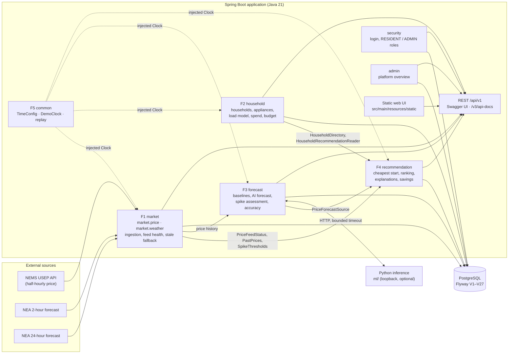

# CS203 Household Energy Market Service

This Spring Boot service stores half-hourly Uniform Singapore Energy Price (USEP)
observations and Singapore two-hour weather forecasts in PostgreSQL. It polls the
[NEMS API](https://nems.sn.sg/) and NEA when the application starts. NEMS is checked
every five minutes and the two-hour NEA feed at 02 and 32 minutes past each hour in
Singapore time. NEMS is an unofficial public service.
Each feed retains its saved history when an upstream fails. No CSV files are written.

USEP is expressed in **SGD/MWh**. It is a wholesale market signal, not a complete household electricity tariff or bill rate.

**Live app:** <https://wattlyapp.me/> (Railway; the same service is also reachable
at `app-production-1d803.up.railway.app`).

**API documentation (Swagger UI):** <https://wattlyapp.me/swagger-ui/index.html>,
or `http://localhost:8080/swagger-ui/index.html` when running locally. The OpenAPI
document is at [`/v3/api-docs`](https://wattlyapp.me/v3/api-docs). Both are public;
the endpoints they describe still require sign-in where noted.

Contents: [Run locally](#run-locally) ·
[Run the demo locally (for markers)](#run-the-demo-locally-for-markers) · [Deploy](#deploy) ·
[Architecture](#architecture) · [Hand-off interfaces](#hand-off-interfaces) ·
[Units and time conventions](#units-and-time-conventions) ·
[Team conventions](#team-conventions) · [API](#api) · [Tests](#tests)

## Run locally

Requirements: Java 21 or newer, and Docker with Compose (or a PostgreSQL server). The Maven wrapper downloads Maven automatically.

```sh
docker compose up -d postgres
./mvnw spring-boot:run
```

The default PostgreSQL connection is `jdbc:postgresql://localhost:55432/energy_market` with local development credentials `energy_market` / `energy_market`. Override it with `DB_URL`, `DB_USER`, and `DB_PASSWORD` for another database. The container port can be changed with `POSTGRES_PORT`.

The application applies the Flyway migration automatically. The NEMS source URL uses the `wattly.nems.base-url` property, which can be overridden with `WATTLY_NEMS_BASE_URL`; the existing `USEP_FEED_URL` environment variable remains supported as a fallback. Set `USEP_POLLING_ENABLED=false` to disable the startup and scheduled polls, such as when running against a prepared test database.

For local frontend testing, start with the opt-in demo profile:

```sh
docker compose up -d postgres
SPRING_PROFILES_ACTIVE=demo ./mvnw spring-boot:run
```

Open `http://localhost:8080/` to sign in. The root URL serves the static
`index.html` login page; its form submits credentials to the `/login` processing
endpoint.

It creates a resident account (`resident` / `resident-demo`) linked to Home and
an admin account (`admin` / `admin-demo`). Passwords are stored as
BCrypt hashes. The demo accounts are created only when missing, and the demo
profile should not be enabled for production deployments.

Sign in as the resident to view only Home. Sign in as the admin to manage the
seeded property portfolio: Home, Office 1, Office 2, Office 3, and Rented Condo.
The labels are defined directly in the V5 and V7 seed migrations. Flyway only
runs those seeds on a fresh database; an existing database that already applied
V5/V7 retains its old seed names, and editing applied migrations changes their
checksums. Use a fresh disposable local database to try the renamed seed data.

### Run the demo locally (for markers)

A plain local run has no live prices and no Python forecast service, so the
Forecast page would be empty. This command runs the app on this machine only and
replays the bundled 26 September 2026 prices instead:

```sh
./scripts/run-local-demo.sh
```

It needs Docker and Java 21 or newer. The first build downloads Maven
dependencies; after that it needs no internet. The script starts the Compose
PostgreSQL container and creates a separate `wattly_local_demo` database if it is
missing. It then runs the app at <http://127.0.0.1:8080/> with the `demo` profile.
NEMS and NEA polling are off. Stop it with Ctrl+C. The settings below are optional:

| Variable | Default | Purpose |
| --- | --- | --- |
| `WATTLY_LOCAL_DEMO_PORT` | `8080` | App port (bound to 127.0.0.1) |
| `WATTLY_LOCAL_DEMO_DB` | `wattly_local_demo` | Database name in the Compose container |
| `POSTGRES_PORT` | `55432` | Host port of the Compose PostgreSQL container |
| `WATTLY_DEMO_REPLAY_DATE`, `WATTLY_DEMO_REPLAY_TIME` | `2026-09-26`, `14:00` | Replay start (Singapore time) |

Sign in with an account from `application-demo.yml`:

- `admin` / `admin-demo`: all five properties and the admin pages.
- `resident` / `resident-demo`: Home only.

On startup the app starts the demo clock as if the admin had pressed Start on
`/admin-demo.html` (setting `WATTLY_DEMO_REPLAY_AUTOSTART`, used only under the
`demo` profile). A bar at the top of every page shows the simulated time.

- **Forecast**: the next 12 hours of the replay day, labelled as a historical
  replay of actual prices, not a model prediction.
- **Recommendations**: demo-forecast suggestions for the price-linked
  properties (Home 3, Office 1 1, Rental 1, Office 2 3). Office 3 is on a fixed-rate
  plan, so it gets none.
- **Households, Appliances, Spending & Budget**: the seeded properties and their
  appliances.

Limits: only the bundled replay days (25 and 26 September 2026) can be loaded. The **+30 min** and **+2 h**
buttons cannot advance past midnight of the replay day; start another day
instead. The demo clock is shared by everyone using this app instance, and
records created during the replay get the simulated time. A fresh database has
no earlier price history, so spike checks and the past-day pattern say there is
not enough history. **Stop** returns the app to real time, where the Forecast page
is empty again without live polling.

## Deploy

Production runs on Railway with the `prod` profile, which requires `DB_URL`,
`DB_USER` and `DB_PASSWORD`. See [docs/deployment.md](docs/deployment.md).

## Architecture

Wattly is a modular monolith: one Spring Boot application (Java 21) split into
feature packages under `sg.edu.smu.cs203`, backed by one PostgreSQL database whose
schema is managed by Flyway (`src/main/resources/db/migration`). Each feature
follows controller → service → repository (Spring `JdbcTemplate`). Features call
each other through the small interfaces listed under
[Hand-off interfaces](#hand-off-interfaces), never through another feature's
tables or repositories. An optional Python inference service (`ml/`) serves the
trained forecast model on loopback; when it is absent or invalid, F3 falls back to
the Java baseline.



| Package | Feature | Responsibility |
| --- | --- | --- |
| `market.price`, `market.weather` | F1 Live Market Engine | Poll NEMS and NEA, store price and weather history, feed health, outage switch, price-gap checks |
| `household` (+ `appliance`, `load`, `spend`, `budget`) | F2 Household Profiling | Households and plans, appliance CRUD, EMA-calibrated load model, month-to-date spend and budget |
| `forecast` | F3 AI Forecaster | Baselines, AI forecast via the Python service, spike assessment, accuracy scoreboard |
| `recommendation` | F4 Recommendation Engine | Cheapest start times, accept/override/dismiss, explanations, confidence, realised savings |
| `common` | F5 Demo Replay / shared | Asia/Singapore `Clock`, `DemoClock`, replay controls |
| `security`, `admin` | Accounts and admin | Login, resident/admin roles, demo accounts, admin overview |

## Hand-off interfaces

These are the agreed boundaries between features (CSDT4-9). Depend on the
interface, not on the implementing feature's repositories or tables. Each lives
in the package of the feature that consumes or owns it, as noted.

| Interface | Owner → consumer | Contract |
| --- | --- | --- |
| [`HouseholdDirectory`](src/main/java/sg/edu/smu/cs203/household/HouseholdDirectory.java) | F2 → F4, spend | `households()` (real households only), `household(id)` (profile, plan, USEP exposure), `flexibleAppliances(id)`, `loadProfile(id, date)` (kWh per half-hour; `null` date = today in Singapore) |
| [`HouseholdRecommendationReader`](src/main/java/sg/edu/smu/cs203/household/HouseholdRecommendationReader.java) | F2 → F4 worker | Read-only household plus flexible appliances for the recommendation worker. Internal only, never a resident API |
| [`PriceForecastSource`](src/main/java/sg/edu/smu/cs203/recommendation/PriceForecastSource.java) | F3 → F4 | `forecast()` returns a forecast F4 may act on, or the reason there is none. `demo` uses the labelled replay-day curve; `f3` uses F3's latest forecast only when it is actionable (`RECOMMENDATION_FORECAST_SOURCE`) |
| [`ForecastPredictor`](src/main/java/sg/edu/smu/cs203/forecast/ForecastPredictor.java) | F3 internal | `predict(knownPrices, asOf)` returns 24 ordered half-hours (SGD/MWh), or an empty list when inputs are insufficient |
| [`PriceFeedStatus`](src/main/java/sg/edu/smu/cs203/recommendation/PriceFeedStatus.java) | F1 → F4 | `stale()` is true when the latest price is `STALE` or none exists; `simulatedOutage()` is true while the admin outage switch is on. Either blocks new recommendations |
| [`PastPrices`](src/main/java/sg/edu/smu/cs203/recommendation/PastPrices.java) | F1 → F4 | Actual half-hourly USEP known by `asOf` (about four weeks), never filled in or guessed |
| [`SpikeThresholds`](src/main/java/sg/edu/smu/cs203/recommendation/SpikeThresholds.java) | F3 rule → F4 | Spike threshold (SGD/MWh) per target half-hour, using only prices known before `asOf`; missing when history is insufficient |
| `java.time.Clock` from [`TimeConfig`](src/main/java/sg/edu/smu/cs203/common/TimeConfig.java) | F5 → all | The only source of business time. It is a `DemoClock`: real Singapore time normally, simulated time while an admin runs a replay |

HTTP contracts between the browser and the backend are the `/api/v1` endpoints in
Swagger UI. The browser never calls the Python service; Spring owns validation,
persistence and fallback.

## Units and time conventions

| Quantity | Stored / API unit | Notes |
| --- | --- | --- |
| Wholesale price (USEP, VCP) | SGD/MWh | Persisted as `NUMERIC`, `BigDecimal` in Java |
| Displayed price | cents/kWh | cents/kWh = SGD/MWh ÷ 10, shown to one decimal place |
| Fixed-rate tariff, planning rate | cents/kWh | Entered in Household Settings and Spending |
| Energy cost | SGD | SGD = kWh × SGD/MWh ÷ 1000; money is always `NUMERIC`/`BigDecimal`, never `double` |
| System demand | MW | NEMS demand forecast |
| Appliance power | kW | Appliance run time is in minutes |
| Household energy | kWh | Load profiles are 48 half-hourly kWh values per day, modelled rather than metered |
| Temperature | °C | Heat-hint threshold defaults to 33°C (inclusive) |

Time rules (see also [Shared Clock rule](#shared-clock-rule-csdt4-21)):

- Get the current time only from the injected `Clock` in `common/TimeConfig`.
  Never call a no-argument `now()` or `System.currentTimeMillis()` in business code.
- Persist moments as instants (`TIMESTAMPTZ`); store times of day, such as an
  appliance's flexibility window, as `TIME`.
- JSON timestamps are ISO-8601 instants. Convert to `Asia/Singapore` for local
  dates, "today", month boundaries and display.
- Prices belong to half-hour periods: `period_start = floor(source_updated / 30 min)`.
  Forecasts cover the next 24 half-hours (12 hours).
- Time-dependent tests use `Clock.fixed(instant, ZoneId.of("Asia/Singapore"))`.

## Team conventions

- **Jira:** every change belongs to a CSDT4 issue. Use its key in the branch name,
  every commit, and the PR title.
- **Branches:** `<type>/CSDT4-<n>-short-description`, created from the latest
  `origin/main`, for example `feat/CSDT4-55-admin-overview` or
  `docs/CSDT4-139-readme-architecture-handoffs`. Types: `feat`, `fix`, `refactor`,
  `docs`, `test`, `chore`, `ci`.
- **Commits and PR titles:** `type(scope): imperative summary [CSDT4-<n>]`, for
  example `fix(forecast): use replay prices while demo is active [CSDT4-35]`.
  Scopes include `market`, `households`, `forecast`, `recommendations`,
  `spending`, `admin`, `demo`, `db`, `ml` and `repo`.
- **Pull requests:** never push to `main`. Open a PR into `main` using the
  [PR template](.github/pull_request_template.md): Jira link, acceptance criteria,
  exact validation results, screenshots for UI changes, and the shared-Clock
  checklist. At least one teammate other than the author must approve the latest
  push, review conversations must be resolved, and the **CI passed** check
  ([workflow](.github/workflows/ci.yml)) must succeed.
- **Merging:** use **Squash and merge** with the PR title as the commit title,
  then delete the branch and move the Jira issue to Done.
- **Secrets and data:** credentials, `.env` files, database dumps and generated
  datasets stay out of Git.

## Run an already restored team dataset

Copy `.env.team-demo.example` to `.env.team-demo`, set `DB_URL` to the restored
database and `WATTLY_TEAM_BUNDLE` to the extracted bundle directory, then run
`./scripts/run-team-demo.sh`. The script loads the local settings, builds the jar,
and serves the saved chart at `/forecast-demo.html`. The database must already be
running and restored; this command does not restore the dump.

The imported dump, chart, and reports are local dataset artifacts and are ignored
by Git. Share the original bundle separately. PostgreSQL holds the restored history;
the `.dump` file is its backup and `public/forecast-demo.json` supplies the dated chart.
Keep `.env.team-demo` local because it contains database credentials.
Once the database is restored, the dump and restore-verification files can be kept
outside this repository as backups. They are not needed to run the app. Keep
`src/main/resources/db/migration/`: Flyway uses those versioned files to validate
the existing schema and initialize new databases.

## API

- `GET /api/v1/market-prices/latest` returns the latest stored price and `LIVE` or `STALE` freshness.
- `GET /api/v1/households/{id}/spend/weekly?month=YYYY-MM` returns each calendar week's modelled spend and its even budget pace for the month.
- `GET /api/v1/households/{id}/savings?period=week|month` returns accepted recommendation runs, realised savings calculated from actual prices, and pending runs that are not counted yet.
- `GET /api/v1/market-prices?from=2026-09-23T00:00:00Z&to=2026-09-24T00:00:00Z` returns historical intervals. The range is at most 31 days.
- `GET /api/v1/market-prices/feed-status` reports the most recent poll result (`SUCCESS`, `STALE_SOURCE`, `FAILURE`, or `NEVER_POLLED`).
- `GET /api/v1/admin/feed-status` (admin) reports NEMS feed health: last poll, last successful sync, consecutive failed polls, uptime % and fallback count for the current month, the open incident and the 10 most recent incidents.
- `GET /api/v1/admin/feed-outage` and `PUT /api/v1/admin/feed-outage` with `{"enabled": true|false}` (admin, CSRF token required) turn a simulated NEMS outage on or off for demos and tests (CSDT4-26). While it is on, every poll fails without calling NEMS, so the latest price is served as `STALE`. Each change triggers one poll immediately, so the dashboard's stale banner appears or clears on its next refresh, without a restart. While it is on, no new recommendations are made either, even from the demo forecast. The switch is held in memory and is always off after a restart.
- `GET /api/v1/admin/overview` (admin) reports households monitored, price-linked households, realised savings this month and the forecast MAE, together with the household summary rows.
- `GET /api/v1/admin/households/summary` (admin) returns each household's plan, realised savings this month, budget status and simulated flag.
- `GET /actuator/health` reports application and database health.
- `/swagger-ui/index.html` displays the API documentation; `/v3/api-docs` returns the OpenAPI document.

`/latest` returns HTTP 503 with `freshness: UNAVAILABLE` if no price has ever been stored. Once a price has been stored, a feed outage does not erase it; the endpoint returns that value with `freshness: STALE`. A successful poll can still be classified as `STALE_SOURCE` if the upstream API responds with an old timestamp. The freshness limit defaults to 40 minutes.

The admin **USEP price feed** panel (CSDT4-48) is `/admin-feed.html` (admin only). It shows the same figures as `GET /api/v1/admin/feed-status` and refreshes every minute, with no placeholder values: before the first poll it shows dashes and "No polls yet".

The admin **platform overview** (CSDT4-55) is `/admin-overview.html` (admin only). It shows platform totals and a household table with simulated households labelled.

Feed health (CSDT4-25) definitions:

- **Incident** (`feed_incident`): opens on the first `FAILURE` or `STALE_SOURCE` poll, with that poll's error as the reason, counts each further failed poll, and closes on the next `SUCCESS`. At most one is open.
- **Consecutive failed polls** and **last successful sync** are read from `ingestion_run`, so a restart does not reset them.
- **Uptime this month** is 100 × (1 − incident time ÷ measured time). Time is measured from the later of the month start (Asia/Singapore) and the first recorded poll. Time while the app was stopped during an open incident counts as down.
- **Fallbacks this month** counts polls that did not return a fresh price, so residents were shown the last stored price marked stale.
- **Price gaps** (CSDT4-27) are half-hours with no row in `market_price`. A check runs at startup and daily at 00:15 Singapore time (`PRICE_GAP_CRON`). It covers the last 7 days (`PRICE_GAP_DAYS`) up to the start of the current half-hour, but never starts before the first recorded poll. Each result is stored in `price_gap_check`, and the latest appears under `priceGaps` in `/api/v1/admin/feed-status`, with consecutive missing half-hours merged into ranges. NEMS only serves the current half-hour, so a gap stays missing until history is imported.

## Tests

```sh
./mvnw test
```

The service targets Java 21. Tests currently cover timestamp normalization and the live, stale, and unavailable decisions. The database upsert uses PostgreSQL `ON CONFLICT` so repeated polls of an interval update one row rather than creating duplicates.

## Combined price and weather history

`V2__combined_observations.sql` adds `market_observation` (one distinct NEMS
payload, with first collection and last seen timestamps) and `weather_observation`
(one NEA issue/update pair, with its full forecast item). Existing `market_price`,
API endpoints, and NEMS ingestion status continue to operate.

The scheduler calls both feeds at startup. It then checks NEMS every five minutes,
so a price published just after a half-hour boundary is picked up on the next retry.
The two-hour NEA feed is still polled at :02/:32 Singapore time.
`USEP_POLL_CRON` and `NEA_POLL_CRON` override their respective schedules; `USEP_POLLING_ENABLED=false`
disables NEMS and both weather collectors by default (the daily collector can be enabled separately). `NEA_FEED_URL` overrides the default official endpoint:
https://api-open.data.gov.sg/v2/real-time/api/two-hr-forecast
Both clients use the existing bounded connection/read timeouts. Each feed is saved
independently. Upstream failures never delete prior rows; NEA failures are logged.
Each NEA response is saved transactionally, so invalid items roll back that batch.

Query `SELECT * FROM combined_observations ORDER BY source_updated_unix` for the
same 66-column layout and column order as `combined_2026-09-23 (1).csv`:

- `record_id`: SHA-256 of PostgreSQL's canonical price JSON; stable within this
  application, not guaranteed to reproduce the sample generator's hash.
- `source_updated_sgt`, `source_updated_unix`, `first_collected_sgt`,
  `last_seen_sgt`, `source_age_seconds_at_collection`, `feed_stale_at_collection`:
  source time, collection history and freshness at first collection (40-minute
  threshold by default). Duplicate prices only advance last seen.
- `usep_sgd_per_mwh`, `demand_forecast_mw`, `vcp_sgd_per_mwh`: NEMS `usep`,
  `demand`, `vcp`; missing VCP remains SQL NULL.
- `weather_match_status`, `weather_issued_sgt`, `weather_updated_sgt`,
  `weather_valid_start_sgt`, `weather_valid_end_sgt`: latest stored forecast issued
  AND updated no later than the price source time, with start <= source < end.
  Status is `matched_as_of_source_update` or `no_matching_weather`. Unmatched
  weather columns remain NULL. The view can fill a match when weather arrives later.
- `price_response_id`, `weather_response_id`: local observation IDs, not upstream
  IDs or the sample's capture-log IDs; repeated observations retain their IDs.
- 47 `weather_<Area_Name>` columns, in the sample's order (Ang Mo Kio through
  Yishun), holding each area's forecast. Additional future areas remain in JSON.
- `price_payload_json`, `weather_item_json`: the four mapped NEMS fields and the
  complete NEA item respectively, stored as JSONB.

Storage uses timezone-aware timestamps; the view formats `_sgt` columns as ISO
8601 strings with `+08:00`. This preserves a compatible shape for future CSV demo
import/export. No demo importer or automatic loading of the supplied CSV is enabled.
Existing historical market rows are not backfilled: their original first-collection
metadata is unavailable. Combined history starts with the next successful poll.

`src/test/resources/combined_observations_test.sql` validates the view on an isolated
PostgreSQL database after applying migrations, using `psql -v ON_ERROR_STOP=1 -f`.

## F2: households and appliances

Households, their electricity plan, appliances with time windows, and a modelled half-hourly
load calibrated to EMA averages. Pages: `/appliances.html`, `/settings.html`,
`/households.html` (add and delete households) and `/about-data.html`. Endpoints and the modelling method are in
[docs/f2-households.md](docs/f2-households.md). Migrations V4–V8 create the tables and load
demo households (the Tans, Lim, Ong, Nair, Rahman) plus 100 simulated households.

## Jira backlog alignment

See [the implementation-to-PBI map](docs/jira-alignment.md) for the verified Jira
keys, delivered backend contracts, and acceptance criteria still requiring UI,
team agreement, or later work. New dashboard-facing endpoints are
`GET /api/v1/prices/current` (one-decimal cents/kWh and staleness) and
`GET /api/v1/weather/today` (daily temperature forecast and configurable heat hint).
The `/dashboard.html` page displays these readings, marks stale and unavailable
states, and refreshes the market price every minute.
The two-hour NEA collector and 66-column demo view remain available.

The shared Clock lives in `common/TimeConfig` and uses Asia/Singapore. All business
time must use that injected clock; the PR template includes this review rule.
The existing price interval rule floors the source timestamp to a half-hour;
EMC settlement-period attribution still needs the CSDT4-11 spike.

## Shared Clock rule (CSDT4-21)

Constructor-inject the `java.time.Clock` bean from `common/TimeConfig` into any
business service that needs the current time. Use `LocalDateTime.now(clock)`
for Singapore local date/time, `LocalDate.now(clock)` for Singapore dates, and
`clock.instant()` or `Instant.now(clock)` for timestamps. Persist timestamps as
instants; do not replace them with local date/time values.

Never call a no-argument `now()`, `System.currentTimeMillis()`, or create another
system Clock in business code. `TimeConfig` provides the shared `DemoClock` as a
`Clock`: it uses real Singapore time normally and a controllable instant when
demo mode is started. Existing services continue to inject `Clock`. Tests should
inject `Clock.fixed(instant, ZoneId.of("Asia/Singapore"))` when time affects behavior.

The main-code review on 26 September 2026 found that the price and weather
services use the injected Clock and no direct system-time calls remain outside
`TimeConfig`. The [PR checklist](.github/pull_request_template.md) applies this
rule to future changes. Feature-lead acknowledgements are tracked in the
[CSDT4-21 acceptance checklist](docs/jira-alignment.md#shared-clock-adoption-csdt4-21).

Admins can control this clock at `/admin-demo.html`. Starting a replay loads the
selected date from the configured replay catalog; advancing moves simulated time
in half-hour periods and refreshes the forecast and dedicated replay household's
suggestions. Starting a new replay clears only that dedicated household's prior
recommendations and decisions so the same demo sequence can be repeated.
During replay, current/history prices, price-linked spend, realised
savings, and recommendation confidence use replay prices only up to simulated
now. Live price ingestion continues on wall-clock time and writes to the normal
market tables. Stopping demo mode immediately returns clock-based features to
real Singapore time.

The demo clock is shared by business services. Therefore, any household,
appliance, budget, or weather record created or updated during replay receives
the simulated timestamp; those existing timestamps are not rewritten when the
demo stops. Automatic recommendation recomputation is paused during replay, and
the forecast page reads the replay forecast while demo mode is active. Replay
forecast runs are marked as demo data and excluded from normal forecast accuracy
and baseline ranking; after demo mode stops, normal forecast runs are shown
again. The replay refresh itself updates only the dedicated replay household's
suggestions.

## F3: forecaster and baseline evaluator

[Local experimental AI activation](docs/forecasting/solar-assisted-ai.md) connects an actual
trained model to the forecast and recommendation pages with explicit labels and fallback.
This optional local mode does not approve a research bundle or establish live savings.

The [F3 final report](docs/final-report-f3.md) records the final fixed candidate comparison,
remaining data/review dependencies and the decision to stop open-ended model searching.
The [delivery handoff](docs/forecasting/delivery-2026-10-29.md) covers runtime verification and inactive WSL weekly preparation.

The [forecast page](/forecast.html) reads saved 24-interval forecasts from Spring.
F3 adds Java baseline fallback, revision-aware history/imports, PostgreSQL forecast
runs, and a separate Python training/inference package under `ml/`. Existing F1
polling and F2 pages remain in place. The standalone collector is unchanged.

Start with the [F3 runbook](docs/forecasting/runbook.md),
[contracts](docs/forecasting/contracts.md), and
[measured results/remaining acceptance work](docs/forecasting/results.md).
The [18 October acceptance report](docs/forecasting/acceptance-2026-10-18.md)
contains the current evidence and remaining dependencies. Official EMC final-price
history now covers June 2025–September 2026. The twelve-month model and 56-day
unseen study are explicitly retrospective; they do not establish what final prices
or future demand forecasts were available historically. Research artifacts remain
unapproved. Live Java baselines continue when Python is absent or invalid.

The [spike sensitivity policy](docs/forecasting/spike-sensitivity-policy.md) retains k=3 and
uses pooled warning budgets with an earlier-control worst-week safeguard for future
research review. It does not activate a new warning model or alter recommendations.

### Model runtime decision (CSDT4-34)

| Option | Benefits | Costs and decision |
| --- | --- | --- |
| A. Train/run inside Java | One application runtime | Reimplementing the existing scikit-learn training/features changes behavior and adds maintenance. Rejected for this implementation. |
| B. Separate Python inference service | Same fitted pipeline and feature code in training, evaluation and serving; pinned supported libraries | A second local process and bounded HTTP dependency. **Selected; preserves the existing architecture.** Java owns validation, persistence and baseline fallback. |
| C. Python training, exported Java inference | One serving runtime and potentially lower request overhead | Requires an export runtime/dependency and verified parity for 24 HGB models, missing values, holidays and demand. No validated export exists here. Deferred; no parity/performance claim. |

Spring callers keep `ForecastService` and saved forecast endpoints; browsers never
call Python. Python binds to loopback, accepts bounded provenance-bearing schema2
JSON, and loads only trusted immutable bundles with matching feature/calendar
checksums and dependencies. Deploy Java21, PostgreSQL15+ and the dedicated pinned
Python3.12 environment; keep model storage persistent and inference private. The
local reproduction uses real Spring/FastAPI HTTP and Chromium, with native
PostgreSQL16.15 and17.11 verified; the Compose container itself was not exercised. No
cloud deployment or performance benchmark was performed. Python reloads an atomic
approved pointer on readiness/forecast requests; failed reloads return503 and Java
falls back. Promotion and rollback never alter a bundle in place.

Resident `/forecast.html` shows saved forecasts and today's actuals. Protected
`/admin-forecast.html` shows seven-day forecast/actual series and common-pair MAE.
For local/demo use only, explicitly set `WATTLY_FORECAST_LOCAL_ADMIN_ENABLED=true`
on Spring plus private `WATTLY_ADMIN_USER` and `WATTLY_ADMIN_PASSWORD`. Credentials
alone do not enable it; there are no defaults. Keep demos on loopback. Production
uses shared authentication with this fallback disabled; server-side ADMIN checks
remain mandatory. See the auth-owner decision below.

A configurable weekly user-systemd timer, audit/failure inspection, paired
challenger validation, reload and rollback are documented in the
[runbook](docs/forecasting/runbook.md). Installation is explicit; verification does
not install a permanent timer pointing at the disposable test application.

## F4: recommendations

The dashboard's "Suggested times" card and `/recommendations.html` page suggest the cheapest start for each flexible
appliance (CSDT4-19) and lets the resident accept, pick their own time, or dismiss (CSDT4-20).
Nothing runs automatically. Migration V10 adds `recommendation` and `recommendation_event`.

By default suggestions use a **demo forecast**: the real prices of the 26 Sep 2026 replay day,
labelled as a demo. Set `RECOMMENDATION_FORECAST_SOURCE=f3` to use F3's forecast once it is
actionable. Why, and what's needed first: [docs/f4-recommendations.md](docs/f4-recommendations.md).

## Spending and budget

`/spending.html` shows this month's modelled daily energy use and estimated spending.
`GET /api/v1/households/{id}/budget` returns the current month, daily estimates, and
the projected total. `PUT` to the same path saves `monthlyBudgetSgd` and
`planningRateCentsPerKwh`; migration V11 stores these per household. Fixed-rate plans
use the rate in Household Settings. Price-linked plans need a resident-entered planning
rate before spending can be estimated. Amounts exclude taxes and fixed fees. These
figures use F2's load model, not meter readings or a live retail bill.

Forecasting review updates: [V15 database compatibility](docs/forecasting/migration-v15.md),
[temporary local admin boundary](docs/forecasting/auth-owner-decision.md), and
[verified research archives](docs/forecasting/artifacts.md). Check migration lineage
before upgrading any persistent database; legacy forecast V12/V13 is not automatically
rewritten or repaired.

### Replay isolation and controls (31 October review)

Run demos on a separate application instance **and a separate database** from the
prospective live trial. The demo clock is global to the instance: it changes the
time seen by residents, pauses ordinary recommendations and serves historical
actual prices as a replay. These are not AI predictions or zero-error evidence.
Never run a replay on the instance recording the AI-versus-B3 trial.

Start, advance and stop are serialized. A transition stages the clock for the
transaction's thread and publishes it to other threads only after the replay
service commits. A failed refresh or commit leaves the published clock unchanged.
Advance rejects crossing the selected Singapore calendar day with HTTP 400; start
another day explicitly. Missing server setup is a server error, not a bad request.
The presenter has one Stop control; restart using the date/time form. Resident
pages stop checking the admin-only demo state after their first 401/403 response.


Before enabling the optional EMC solar/demand collector, read the
[permission decision](docs/forecasting/emc-collection-permission.md). Public page
access is not verified permission for automated collection. The review did not
make a new collection request, deploy repaired code or change the running trial.


Local model selection was switched on 31 October to the separately trained
[price-only AI](docs/forecasting/price-only-ai-2026-10-31.md). Its new AI/B3 comparison
is separate from the preserved solar trial. Solar and future-demand signals are
not required by this predictor; the ordinary market-price feed remains required.
